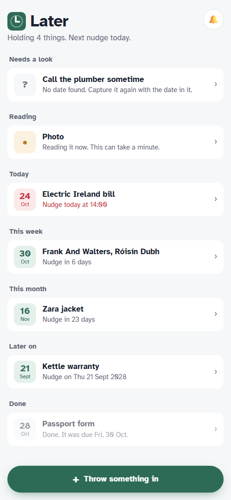

# Later 🦥

Snap it, say it or type it. Later works out what you'll need to do and the last sensible day to do it, then stays quiet until then and nudges you once.

**Live:** https://later-h5nw.onrender.com · Built for the Hacktoberfest 2026 Open-Source AI Challenge, Week 3: Slow and Steady.



## How it works

```
phone ──capture──▶ FastAPI ──store──▶ MongoDB Atlas
                      │
                      └─start──▶ Temporal workflow (one per item)
                                   1. read_item   ── Gemma 4 31B (open weights) reads the text or photo
                                   │                  retried patiently: the free endpoint fails ~1 call in 3
                                   2. resolve     ── plain code turns facts into a deadline (the model never does date maths)
                                   3. sleep until the last sensible moment (days or months; survives restarts)
                                   4. send_reminder ── one ntfy push with signed Done / Snooze buttons
```

- **The model reports facts, code does the maths.** Gemma copies dates and windows ("30 day returns") exactly as written; `later/resolve.py` computes the deadline in Irish time, including month ends and clock changes.
- **Reading happens in the background.** Capture returns instantly; a Temporal activity reads it with retries for up to 2 hours.
- **No accounts.** Each visitor gets an anonymous cookie and a private ntfy topic; push buttons carry a signed per-item token. Daily capture limits protect the model quota.

## Results

Gemma 4 31B on Google AI Studio, full pipeline (`eval/run.py`):

| Set | Due date right | Kind right | Model calls that failed | Captures lost |
|---|---|---|---|---|
| 30 hand-written captures (27 typed, 3 drawn images) | 30/30 | 28/30 | 16 of 46 (35%) | 0 |
| 5 real Galway event listings (3 typed, 2 page screenshots) | 5/5 | 5/5 | 1 of 6 | 0 |

Details in [`eval/results`](eval/results).

## Run it

```bash
python -m venv .venv && .venv/Scripts/pip install -r requirements.txt pytest pytest-asyncio pytest-timeout
cp .env.example .env                # fill in LLM_API_KEY, MONGODB_URI, LATER_SECRET
temporal server start-dev           # in one terminal
python -m later.worker              # in another
uvicorn later.app:app --port 8000   # and the web app
pytest                              # 112 tests; Temporal tests use the time-skipping test server
```

Any OpenAI-compatible endpoint works: set `LLM_BASE_URL` and `LLM_MODEL`. Deploy: `render.yaml` runs Temporal, the worker and the app in one container with a persistent disk.

## Stack

Gemma 4 (open weights) · Temporal · MongoDB Atlas · Render · FastAPI · ntfy · optional: ElevenLabs speech-to-text, SerpApi return-policy lookup, Sentry tracing.

MIT licensed.
